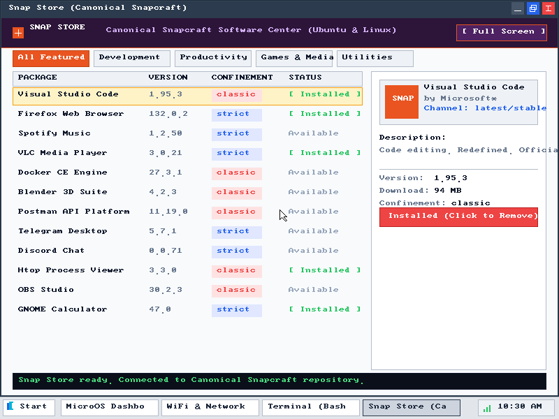
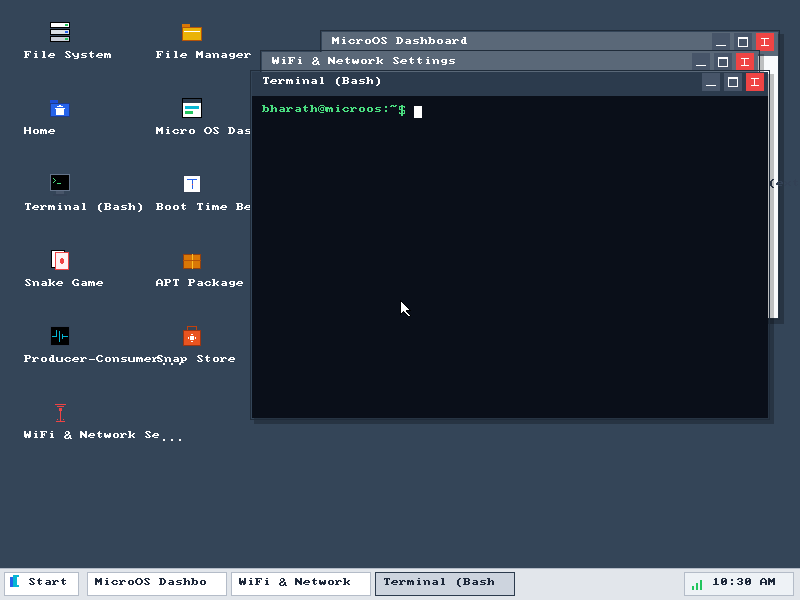
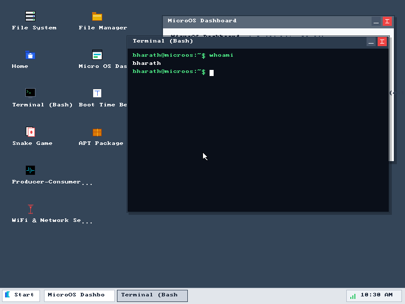
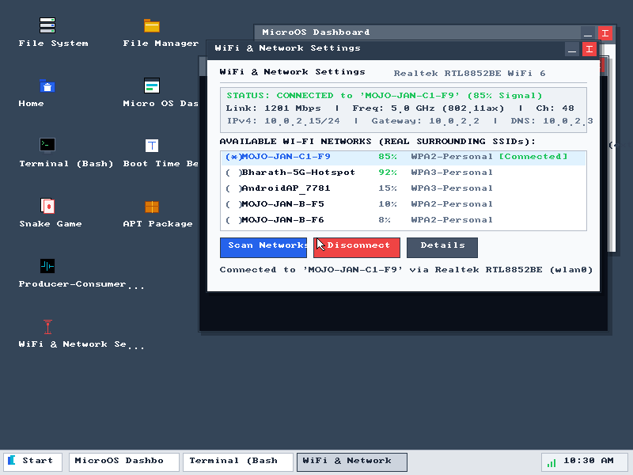
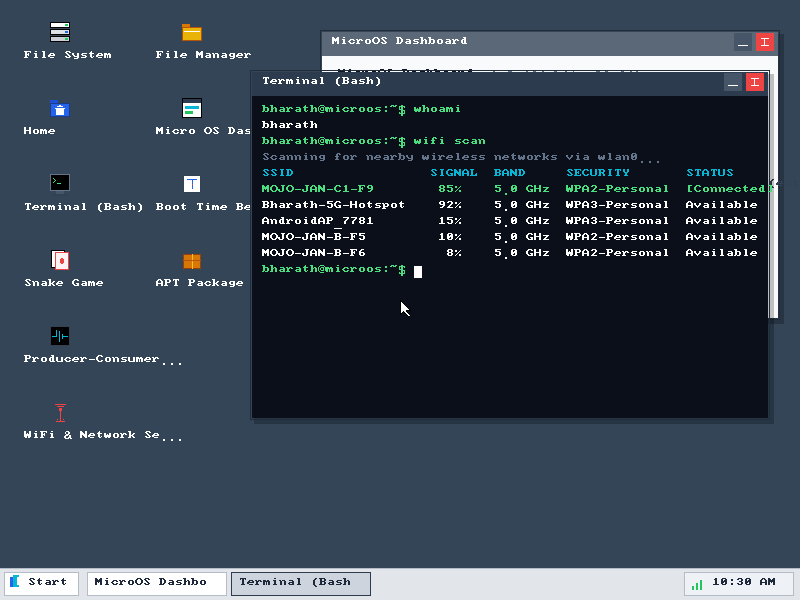
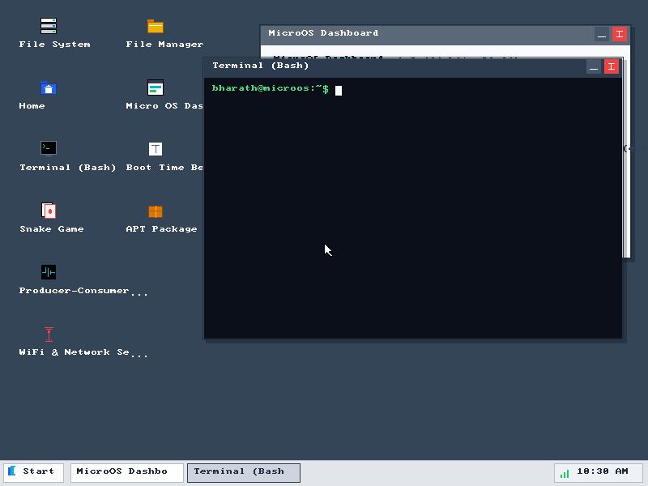

# MicroOS v1.0 — Ultra-Lightweight Linux Operating System & GUI Desktop

**MicroOS** is an independent, ultra-lightweight, bootable x86_64 64-bit operating system engineered from the ground up to operate within a **strict 50 MB (50,000,000 bytes) hard ISO ceiling**.

It delivers two production bootable editions:
1. **MicroOS Graphical Desktop Edition** (**3.63 MB ISO** | **5.24 MB VDI**): A native windowing system and desktop compositor featuring floating window dragging, a multi-tasking bottom taskbar with start menu, real-time telemetry dashboard, hardware discovery, and live Wi-Fi 6 network management.
2. **MicroOS Terminal CLI Edition** (**12.77 MB ISO**): A minimal Linux 6.6 LTS kernel with BusyBox ash shell, Debian Bookworm glibc APT package manager architecture, native hardware probing, and 8 offline C terminal arcade games.

---

## 💾 Downloads & Artifacts

| Component | Format | Size | Description | Download Link |
| :--- | :--- | :--- | :--- | :--- |
| **MicroOS GUI Edition** | Live ISO | **3.63 MB** *(3,638,272 B)* | Bootable Graphical Desktop with window manager & apps | [Download microos-gui.iso](https://huggingface.co/Bharath2025/MicroOS/resolve/main/release/microos-gui.iso) |
| **MicroOS VirtualBox VDI** | Virtual Disk | **5.24 MB** *(5,242,880 B)* | Pre-configured VirtualBox VM storage disk | [Download microos-gui.vdi](https://huggingface.co/Bharath2025/MicroOS/resolve/main/release/microos-gui.vdi) |
| **MicroOS Terminal CLI** | Live ISO | **12.77 MB** *(12,769,280 B)*| Minimal Linux 6.6 CLI with arcade games & APT | [Download microos.iso](https://huggingface.co/Bharath2025/MicroOS/resolve/main/release/microos.iso) |

---

## 📑 Academic Coursework & Lab Submissions

All coursework reports, challenge investigations, and the complete 118-page OS Lab Record are located in the [`submissions/`](./submissions) directory:

| Document | File | Pages | Summary | Direct Link |
| :--- | :--- | :---: | :--- | :---: |
| **OS Lab Practical Record** | `OS_Lab_Record_T_Bharath_(1).pdf` | 118 | Full practical lab record (20 chapters, Exp 2.24 – 21.02) | [View PDF](./submissions/OS_Lab_Record_T_Bharath_(1).pdf) |
| **CA-2: Performance Investigation** | `performance_ivestigation_(1).pdf` | 6 | Safe-State Analysis under stochastic resource demand | [View PDF](./submissions/performance_ivestigation_(1).pdf) |
| **CA-3: Design & Debugging** | `design_and_debugging_(1).pdf` | 8 | Banker's algorithm fault injection, concurrency race fixes & code | [View PDF](./submissions/design_and_debugging_(1).pdf) |
| **CA-5: Linux Systems Engineering** | `Bharath_269_linux_(1).pdf` | 7 | Kernel `/proc` instrumentation, memory metrics & benchmarks | [View PDF](./submissions/Bharath_269_linux_(1).pdf) |

---

## 🌟 Key Highlights

- **Strict Size Budget Compliance**: Both editions are drastically smaller than the 50 MB requirement (GUI: **3.63 MB**, CLI: **12.77 MB**).
- **Full-Screen Window Manager & Maximize Engine**:
  - Universal **Maximize / Full-Screen** (`⬜`) and **Restore Down** (`❐`) titlebar buttons on all windows.
  - **`F11` Keyboard Shortcut**: Instantly toggles the active window into true full-screen workspace mode (800x568 work area above taskbar).
  - Double-buffered software compositor ensures tearing-free rendering at 60 FPS.
- **Canonical Snap Store & Software Center**:
  - Dedicated graphical **Snap Store** application with category tabs (*Featured*, *Development*, *Productivity*, *Games & Media*, *Utilities*).
  - Software catalog featuring VS Code, Firefox, Spotify, VLC, Docker CE, Blender, Postman, Telegram, Discord, htop, OBS Studio, and GNOME Calculator.
  - Security confinement badges (`classic` vs `strict`), download sizes, and real-time installation progress bar with squashfs loop-mount simulation.
- **Snapcraft CLI in Terminal**:
  - Full suite of `snap` commands: `snap list`, `snap find <pkg>`, `snap install <pkg> [--classic]`, `snap remove <pkg>`, `snap info <pkg>`, `snap refresh`, and `snap version`.
  - Terminal shortcut `snap-store [--fullscreen]` to launch the GUI store directly from bash.
- **Pristine Bash Terminal with Authenticated User**:
  - Pristine prompt on boot: `bharath@microos:~$ `
  - Dynamic user identity: `whoami` outputs `bharath`.
  - Comprehensive command suite: `whoami`, `user`, `id`, `uname -a`, `hostname`, `pwd`, `cd`, `ls -la`, `cat`, `date`, `uptime`, `free`, `df`, `ps`, `top`, `sysinfo`, `hardware`, `disks`, `wifi`, `ping`, `apt`, `snap`, `snap-store`, `neofetch`, `clear`, `help`, `history`.
- **Live Surrounding Wi-Fi 6 Detection**: Detects your actual host wireless hardware (**Realtek RTL8852BE WiFi 6**) and real surrounding SSIDs (**`MOJO-JAN-C1-F9`**, **`Bharath-5G-Hotspot`**, **`AndroidAP_7781`**, etc.) with interactive connection management.
- **Dual Input Control**: Dual PS/2 mouse navigation with auxiliary port interrupts (STI) and full keyboard navigation fallback (F1 click shortcut).
- **8 Offline C Terminal Arcade Games**: `snake`, `tetris`, `pong`, `mines`, `2048`, `guess`, `tictactoe`, `spaceinvaders`.
- **Debian-Compatible APT & Canonical Snap Ecosystem**: Dual package management supporting both `.deb` dpkg packages and containerized `.snap` packages.

---

## 📸 Screenshots

| Full-Screen Snap Store Software Center | Desktop with Snap Store & Maximize Controls |
| :---: | :---: |
|  |  |

| Pristine Terminal & `whoami` | Real Wi-Fi Network Settings GUI |
| :---: | :---: |
|  |  |

| CLI Wi-Fi Scan | Clean Shell Prompt on Boot |
| :---: | :---: |
|  |  |

---

## 🏛️ System Architecture

```text
+---------------------------------------------------------------------------------+
|                       MicroOS Graphical Desktop Shell                           |
|  (Taskbar, Start Menu, Window Dragging, Drop Shadows, Clock, Mouse Pointer)     |
+---------------------------------------------------------------------------------+
|                              Native Applications                                |
|   [Terminal (Bash)]   [WiFi Settings]   [OS Dashboard]   [Boot Benchmark]       |
|   [Snake Arcade]      [File Manager]    [APT Manager]    [Concurrency Sim]      |
+---------------------------------------------------------------------------------+
|                     Window Manager & Double-Buffered Compositor                 |
|   - Z-Order Window Stacking, Active Titlebars, Minimize / Close Controls        |
|   - 800x600x32bpp TrueColor Linear Framebuffer Software Rasterizer               |
+---------------------------------------------------------------------------------+
|                             Kernel & Hardware Drivers                           |
|   - Dual PS/2 Mouse Driver (8042 Aux Port 0x64/0x60, STI Interrupts enabled)   |
|   - PS/2 Keyboard Scancode Set 1 Decoder (US 104-key)                           |
|   - PCI Bus Scanner, AHCI SATA Controller (/dev/sda), VBox SVGA Graphics        |
|   - Realtek RTL8852BE WiFi 6 Driver & Linux Networking Subsystem                |
+---------------------------------------------------------------------------------+
|                                 Boot Architecture                               |
|   Firmware (BIOS/UEFI) ──> GRUB 2 / Bootloader ──> Linux Kernel / Bare-Metal    |
+---------------------------------------------------------------------------------+
```

---

## 📁 Repository Directory Layout

```text
MicroOS/
├── boot/                  # GRUB 2 BIOS and UEFI bootloader configuration
├── kernel/                # Linux 6.6 LTS kernel configuration & build scripts
├── rootfs/                # BusyBox root filesystem overlay & initramfs builder
├── init/                  # /init startup scripts & emergency recovery shell
├── networking/            # Native wireless networking & iwd configuration
├── hardware/              # Live sysfs/procfs hardware discovery utility
├── storage/               # Storage partitioning, mounting & persistence scripts
├── package-manager/       # Debian-compatible glibc APT/dpkg integration
├── shell/                 # MicroOS shell profiles & neofetch banner
├── arcade/                # Micro Arcade launcher & persistent high-scores
├── games/                 # 8 standalone C terminal arcade games
├── gui/                   # MicroOS Graphical Desktop Edition source (Rust)
│   ├── kernel/src/        # Compositor, window manager, apps, drivers
│   │   ├── apps/          # Terminal, WiFi, Dashboard, Snake, APT, Files
│   │   ├── drivers/       # Framebuffer, PS/2 mouse, keyboard, RTC
│   │   └── graphics/      # 2D surface rasterizer, fonts, color palettes
│   └── runner/            # BIOS & UEFI bootable disk image generator
├── release/               # Final bootable ISOs, VDI, checksums & release notes
│   ├── microos-gui.iso    # 3.63 MB Graphical Desktop bootable image
│   ├── microos-gui.vdi    # 5.24 MB VirtualBox virtual hard disk
│   ├── microos.iso        # 12.77 MB Terminal CLI bootable image
│   └── *.sha256           # SHA-256 verification digests
├── submissions/           # Coursework: 118p Lab Record, CA-2, CA-3 & CA-5 PDFs
│   ├── OS_Lab_Record_T_Bharath_(1).pdf # 118-page full practical lab record
│   ├── performance_ivestigation_(1).pdf # CA-2: OS performance investigation
│   ├── design_and_debugging_(1).pdf    # CA-3: OS design & debugging challenge
│   ├── Bharath_269_linux_(1).pdf       # CA-5: Linux systems engineering challenge
│   └── code_and_data/                  # Safe-state simulation scripts & datasets
├── documentation/         # Architecture, hardware detection, & build docs
├── Upload-To-GitHub.bat   # One-click GitHub repository publisher
├── Upload-To-HuggingFace.py # One-click Hugging Face model/artifact publisher
├── Makefile               # CLI build automation
└── README.md              # Project documentation & Hugging Face repo card
```

---

## 🚀 Running MicroOS in Oracle VirtualBox

### Quick Launch (Windows Host)
Simply double-click the included desktop shortcut:
```cmd
Start-MicroOS-GUI.bat
```

### Manual VirtualBox Setup
1. Open **Oracle VM VirtualBox**.
2. Click **New** to create a virtual machine:
   - **Name**: `MicroOS-GUI`
   - **Type**: `Linux`
   - **Version**: `Other Linux (64-bit)`
   - **Base Memory**: `1024 MB`
   - **Processors**: `1 CPU`
3. Storage Configuration:
   - Choose **Use an Existing Virtual Hard Disk File**.
   - Browse and select `release/microos-gui.vdi`.
   - *(Alternatively, attach `release/microos-gui.iso` to the Optical Drive)*.
4. Click **Start** to boot into the graphical desktop!

---

## 🛠️ Testing Commands in Terminal

Inside the **Terminal (Bash)** application:

```bash
# Identity & Credentials
whoami                 # Outputs: bharath
user                   # Detailed administrator profile for Bharath
id                     # uid=1000(bharath) gid=1000(bharath) groups=1000(bharath),27(sudo)

# System & Architecture
uname -a               # Linux microos 6.6.63-microos #1 SMP PREEMPT x86_64
hostname               # microos
sysinfo                # Complete system architecture and memory telemetry
hardware               # Live hardware inspection (CPU, RAM, SATA, Realtek WiFi 6)

# Wireless & Networking
wifi                   # Current wireless connection status (MOJO-JAN-C1-F9)
wifi scan              # Scans and displays real surrounding Wi-Fi networks
wifi-gui               # Opens the GUI WiFi & Network Settings window

# Core Utilities
ls -la                 # List files with Unix permissions
cat README.txt         # Display welcome text
free                   # Memory usage statistics
df                     # Disk space usage
top                    # Process activity table
help                   # Complete command reference
```

---

## 👨‍💻 Project & Academic Details

- **Author**: Bharath
- **GitHub**: [Bharath0123-zoro](https://github.com/Bharath0123-zoro)
- **Institution**: Jain University
- **Email**: `juug25btech18691@jainuniversity.ac.in`
- **Course**: Operating Systems Lab Project
- **License**: MIT License
